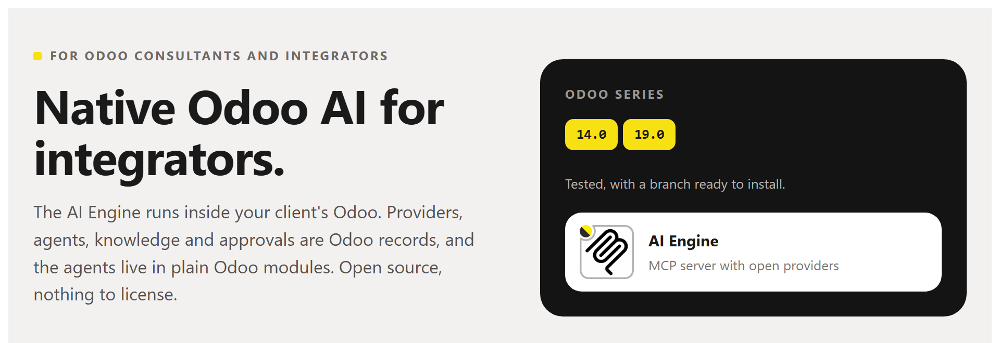

# AI Engine (pns_ai_mcp) — native Odoo AI for integrators



The AI Engine runs inside your client's Odoo. Providers, agents, knowledge
and approvals are Odoo records, and the agents live in plain Odoo modules.
Open source, nothing to license. Odoo **14.0** and **19.0**.

*Español más abajo.*

## The pain

**You want native Odoo AI for every client: open source, built on modules, with no licences.**
Not a service on the side that you connect client by client. An AI that
installs, updates and uninstalls like any other module, on the Odoo the
client already runs. Here the agents live in plain Odoo modules.

| | |
| :--- | :--- |
| **01 — Tied to one provider?** | Add several, each for its job: conversation, audio, vision, video. If one fails, the next one answers. |
| **02 — What if the AI writes in production?** | Its code runs in a read-only sandbox. To change anything it proposes a plan, and a person approves it. |
| **03 — A closed prompt that does not know your client?** | Contexts are edited and extended inside Odoo: their vocabulary, their rules, their habits. |

## What you get

**Agents that are Odoo**
- An agent is a record that a module brings with it. Install the module and the agent is there; uninstall it and it goes.
- Each agent has its own list of providers, in the order you set.
- Everything is in the client's database: no second copy somewhere else.

**Providers for each task**
- OpenAI and any OpenAI-compatible endpoint, Anthropic, OpenRouter. A local model (Ollama, LM Studio) on the client's own server works too.
- Roles per provider: conversation, audio, vision, video, page layout, turning a phrase into a skill's fields, yes-or-no decisions.
- If one provider fails, the next one in the list answers.
- The client pays the provider directly. The key stays in their database, never in the module.

**A sandbox and a person**
- The code the AI writes reads in a read-only transaction, with the rights of the person who asked.
- A change to Odoo is a plan that waits for a person to approve it in Odoo.
- Every call is logged: each user sees their own activity, the administrator sees all of it.
- Outside addresses only from a whitelist you keep.

**Knowledge you own**
- Contexts: the client's words, rules and habits, edited in Odoo.
- Skills: procedures written once and launched by name. Their tables and charts come from code, not from the AI.
- Export the whole AI setup of one client to a file and import it at the next one.

**An MCP server in the client's Odoo**
- Cursor and other MCP clients connect to `/mcp` with a personal key.
- No admin password goes anywhere. Each key reads with its user's rights.
- The client's own model does the thinking; Odoo answers its tool calls. No provider needed for that.

**Nothing to license**
- Apache 2.0. No fee per user, per database or per year.
- A plain Odoo module: no external server to run.
- Same module at every client on a supported series.

## Getting started at a client

1. **Start on a copy.** Restore a copy of the client's database on your test server. Try it there first.
2. **Python extras (Odoo 14 only).** In the Python that runs Odoo, before Apps. On Odoo 19 there is nothing to add.
   ```bash
   pip install "openpyxl>=3.1.2"
   ```
3. **Get the code.** Clone the branch of the client's series (`14.0` or `19.0`) of `pns_ai_mcp` and `pns_base` into the addons path. Update the Apps list and install the AI Engine. Odoo installs `pns_base` with it.
4. **Open the AI menu.** *Settings → Users*: give yourself **AI Administrator** (section Artificial Intelligence). Log out and back in: the **AI Engine** menu appears.
5. **Give access.** *AI Engine → Security → Users*: one row per person, you included. Tick **AI Conversational**. For an MCP client, press **Generate API Key** and copy it: it is shown once.
6. **Connect an AI.** *AI Engine → Connections → Providers*: create one, choose the protocol, paste the endpoint and API key, pick a model and tick its roles (at least **Conversation**). Add more providers for audio, vision or as a backup.
7. **Teach it the client.** *AI Engine → Knowledge*: contexts with their vocabulary and rules, skills for their routines.
8. **Connect an MCP client.** Point it at `/mcp` on the instance and send the key in the `X-MCP-API-Key` header. The key is not accepted in the URL. For Cursor, in `mcp.json`:
   ```json
   { "mcpServers": { "client-odoo": {
       "url": "https://odoo.example.com/mcp",
       "headers": { "X-MCP-API-Key": "<the key you copied>" } } } }
   ```

**Before you go wide:** the AI answers what the person asking can see in Odoo, nothing more. Try it with a user who sees everything, then hand it to the rest.

<details>
<summary><strong>Español</strong></summary>

## IA nativa de Odoo para instaladores

El Motor de IA corre dentro del Odoo de tu cliente. Proveedores, agentes,
conocimiento y aprobaciones son registros de Odoo, y los agentes viven en
módulos normales de Odoo. Código abierto, nada que licenciar. Odoo **14.0** y **19.0**.

### El dolor

**Quieres IA nativa de Odoo para todos tus clientes: de código abierto, basada en módulos y sin licencias.**
No un servicio al lado que conectas cliente a cliente. Una IA que se instala,
se actualiza y se desinstala como cualquier otro módulo, en el Odoo que el
cliente ya tiene. Aquí los agentes viven en módulos normales de Odoo.

| | |
| :--- | :--- |
| **01 — ¿Atado a un proveedor?** | Pon varios, cada uno para lo suyo: conversación, audio, imagen, vídeo. Si uno cae, responde el siguiente. |
| **02 — ¿Y si la IA escribe en producción?** | Su código corre en una caja de arena de solo lectura. Para cambiar algo propone un plan, y lo aprueba una persona. |
| **03 — ¿Un prompt cerrado que no conoce a tu cliente?** | Los contextos se editan y se amplían en el propio Odoo: su vocabulario, sus reglas, sus costumbres. |

### Qué te llevas

**Agentes que son Odoo**
- Un agente es un registro que trae un módulo. Instalas el módulo y el agente está; lo desinstalas y se va.
- Cada agente tiene su propia lista de proveedores, en el orden que tú pongas.
- Todo está en la base de datos del cliente: no hay una segunda copia en otro sitio.

**Proveedores para cada tarea**
- OpenAI y cualquier servicio compatible con OpenAI, Anthropic, OpenRouter. También un modelo local (Ollama, LM Studio) en el propio servidor del cliente.
- Roles por proveedor: conversación, audio, imagen, vídeo, maquetar una página, pasar una frase a los campos de un skill, decisiones de sí o no.
- Si un proveedor falla, responde el siguiente de la lista.
- El cliente paga al proveedor directamente. La clave se queda en su base de datos, nunca en el módulo.

**Una caja de arena y una persona**
- El código que escribe la IA lee en una transacción de solo lectura, con los permisos de quien preguntó.
- Un cambio en Odoo es un plan que espera a que una persona lo apruebe en Odoo.
- Cada llamada queda registrada: cada usuario ve su actividad, el administrador la de todos.
- Direcciones de fuera, solo las de una lista blanca que tú mantienes.

**Conocimiento tuyo**
- Contextos: las palabras, reglas y costumbres del cliente, editadas en Odoo.
- Skills: procedimientos que se escriben una vez y se lanzan por su nombre. Sus tablas y gráficos salen del código, no de la IA.
- Exportas toda la configuración de IA de un cliente a un fichero y la importas en el siguiente.

**Un servidor MCP en el Odoo del cliente**
- Cursor y otros clientes MCP se conectan a `/mcp` con una clave personal.
- Ninguna contraseña de administrador sale de Odoo. Cada clave lee con los permisos de su usuario.
- Piensa el modelo del propio cliente MCP; Odoo responde a sus llamadas. Para eso no hace falta proveedor.

**Nada que licenciar**
- Apache 2.0. Sin cuota por usuario, por base de datos ni por año.
- Un módulo de Odoo normal: sin servidor externo que mantener.
- El mismo módulo en todos los clientes de una versión soportada.

### Puesta en marcha en un cliente

1. **Empieza en una copia.** Restaura una copia de la base de datos del cliente en tu servidor de pruebas. Pruébalo ahí primero.
2. **Extras de Python (solo Odoo 14).** En el Python que ejecuta Odoo, antes de Aplicaciones. En Odoo 19 no hay que añadir nada.
   ```bash
   pip install "openpyxl>=3.1.2"
   ```
3. **Trae el código.** Clona la rama de la versión del cliente (`14.0` o `19.0`) de `pns_ai_mcp` y de `pns_base` en el addons path. Actualiza la lista de Aplicaciones e instala el Motor de IA. Odoo instala `pns_base` con él.
4. **Abre el menú de IA.** *Ajustes → Usuarios*: date **IA Administrador** (apartado Inteligencia Artificial). Sal y vuelve a entrar: aparece el menú **Motor de IA**.
5. **Da acceso.** *Motor de IA → Seguridad → Usuarios*: una fila por persona, tú incluido. Marca **IA Conversacional**. Para un cliente MCP, pulsa **Generar Clave API** y cópiala: solo se enseña una vez.
6. **Conecta una IA.** *Motor de IA → Conexiones → Proveedores*: crea uno, elige el protocolo, pega la dirección y la clave API, elige un modelo y marca sus roles (como mínimo **Conversación**). Añade más proveedores para audio, imagen o de reserva.
7. **Enséñale al cliente.** *Motor de IA → Conocimiento*: contextos con su vocabulario y sus reglas, skills para sus rutinas.
8. **Conecta un cliente MCP.** Apúntalo a `/mcp` de la instancia y manda la clave en la cabecera `X-MCP-API-Key`. En la URL no se acepta. Para Cursor, en `mcp.json`:
   ```json
   { "mcpServers": { "odoo-cliente": {
       "url": "https://odoo.example.com/mcp",
       "headers": { "X-MCP-API-Key": "<la clave que copiaste>" } } } }
   ```

**Antes de abrirlo a todos:** la IA responde lo que la persona que pregunta puede ver en Odoo, nada más. Pruébalo con un usuario que lo ve todo y luego dáselo al resto.

</details>

---

## For developers

### Repository layout

`main` is one tree for every series. A flat branch (`14.0`, `19.0`) is that tree built for one series, ready for the addons path.

| Path | Contents |
| :--- | :--- |
| `common/` | Version-agnostic code, skills, contexts, data, Apps sheet |
| `stacks/owl1/pns_ai_mcp/` | Odoo 14 |
| `stacks/owl2/pns_ai_mcp/` | Odoo 15 and later |

The installer overlays `common/` then the stack; a stack file with the same
path wins. Edit agnostic files only in `common/`. Build a flat module with
`./install_flat.sh 19.0 /path/to/addons`. Domain UI helpers: `utils/mcp_ui.py`.

Python: do not add `requests` or `reportlab` (Odoo already ships them).
`pns_base` needs no extra pip. On 14, use a current `openpyxl` (old wheels
break with recent NumPy).

### Odoo versions

| Series | Status |
| :--- | :--- |
| 14.0, 19.0 | Tested. Flat branch published. |
| 15.0 – 18.0 | `install_flat.sh` builds them and warns that they are not tested yet. |
| 13.0 and older | Not supported. |

Odoo 13 has no OWL, which the AI chat is built on. Odoo 8 to 12 run on a
Python older than 3.7, which the engine needs. The suite keeps two stacks
(`owl1` for 14.0, `owl2` for 15.0 and later).

### Tests

| Where you are | What runs |
| :--- | :--- |
| `main` | `python -m pytest unit_tests`, with no Odoo. Then the Odoo tests, after `./install_flat.sh 19.0 <dir>`. |
| A flat branch (`14.0`, `19.0`) | The Odoo tests in `tests/`. The unit tests live on `main`. |

```bash
odoo-bin -d <db> -i pns_ai_mcp --test-enable --stop-after-init --test-tags /pns_ai_mcp
```

## License, marks, training

Apache-2.0 — see [LICENSE](LICENSE) and [NOTICE](NOTICE).
PATANEGRA Soft™ and PAAP™ (Patanegra Application Agent Protocol, which this
engine implements) are trademarks of PATANEGRA Soft SL; the license does
not grant them. TDM / AI training is allowed (TDMRep `tdm-reservation = 0`).

Security: [SECURITY.md](SECURITY.md). Bugs, ideas and questions: [CONTRIBUTING.md](CONTRIBUTING.md).
