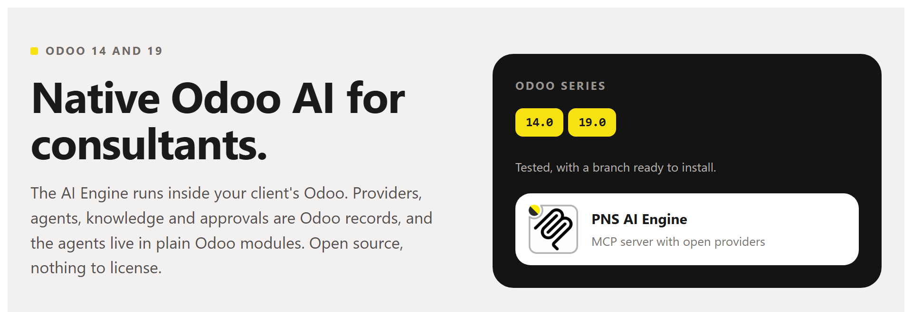
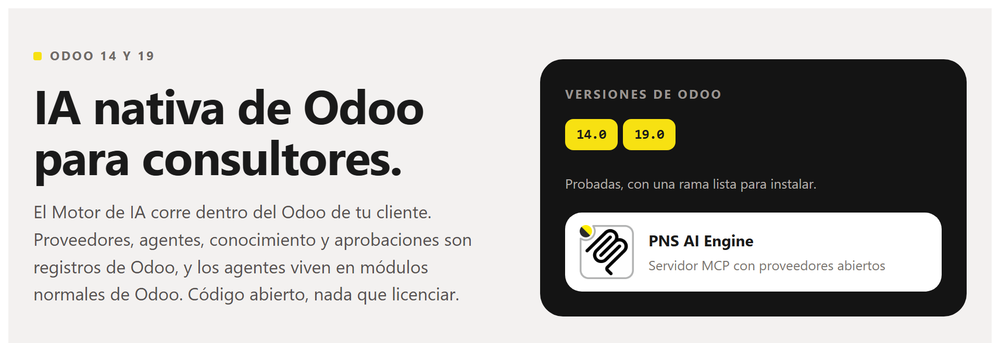

# PNS AI Engine (pns_ai_mcp)



**[English](#english) · [Español](#español)**

## English

**Native Odoo AI for consultants.** The AI Engine runs inside your client's
Odoo. Providers, agents, knowledge and approvals are Odoo records, and the
agents live in plain Odoo modules. Open source, nothing to license. Odoo
**14.0** and **19.0**.

### The pain

**You want native Odoo AI for every client: open source, built on modules, with no licences.**
Not a service on the side that you connect client by client. An AI that
installs, updates and uninstalls like any other module, on the Odoo the
client already runs. Here the agents live in plain Odoo modules.

| | |
| :--- | :--- |
| **01 — Tied to one provider?** | Add several, each for its job: conversation, audio, vision, video. If one fails, the next one answers. |
| **02 — What if the AI writes in production?** | Its code runs in a read-only sandbox. To change anything it proposes a plan, and a person approves it. |
| **03 — A closed prompt that does not know your client?** | Contexts are edited and extended inside Odoo: their vocabulary, their rules, their habits. |

### What you get

**Agents that are Odoo**
- An agent is a record that a module brings with it. Install the module and the agent is there; uninstall it and it goes.
- Each agent has its own list of providers, in the order you set.
- Everything is in the client's database: no second copy somewhere else.

**Providers for each task**
- OpenAI and any OpenAI-compatible endpoint, Anthropic, OpenRouter. A local model (Ollama, LM Studio) on the client's own server works too.
- Roles per provider: conversation, audio, vision, video, page layout, turning a phrase into a skill's fields, yes-or-no decisions.
- If one provider fails, the next one in the list answers.
- The key stays in the client's database, never in the module.

**A sandbox and a person**
- The code the AI writes reads in a read-only transaction, with the rights of the person who asked.
- A change to Odoo is a plan that waits for a person to approve it in Odoo.
- Every call is logged: each user sees their own activity, the administrator sees all of it.
- Outside addresses only from a whitelist you keep.

**Knowledge you own**
- Contexts: the client's words, rules and habits, edited in Odoo.
- Skills: procedures written once and launched by name. Their tables and charts come from code, not from the AI.
- Export the whole AI setup of one client to a file and import it at the next one.

**An MCP server in the client's Odoo**
- Cursor and other MCP clients connect to `/mcp` with a personal key.
- No admin password goes anywhere. Each key reads with its user's rights.
- The client's own model does the thinking; Odoo answers its tool calls. No provider needed for that.

**Nothing to license**
- Apache 2.0. No fee per user, per database or per year.
- A plain Odoo module: no external server to run.
- Same module at every client on a supported series.

### Getting started

1. **Install.** Clone the `14.0` or `19.0` branch of `pns_ai_mcp` and `pns_base` into the addons path and install **PNS AI Engine** from Apps. On Odoo 14, first run `pip install "openpyxl>=3.1.2"`.
2. **Become AI administrator.** *Settings → Users*: give yourself **AI Administrator**. Log out and back in.
3. **Get your API key.** *AI Engine → Security → Users*: your row, tick **AI Conversational** and press **Generate API Key**.
4. **Add a provider.** *AI Engine → Connections → Providers*: protocol, endpoint, API key and model, with the **Conversation** role.

**Done.** Point Cursor (or any MCP client) at `https://<your-odoo>/mcp` with the key in the `X-MCP-API-Key` header. Example below, in *Connecting an MCP client*.

### For IT staff

#### Connecting an MCP client

In Cursor, add the server to `~/.cursor/mcp.json` (all projects) or to
`.cursor/mcp.json` (one project). Other MCP clients take the same two
things: the URL and the header.

```json
{
  "mcpServers": {
    "my-client-odoo": {
      "url": "https://odoo.example.com/mcp",
      "headers": {
        "X-MCP-API-Key": "<your-api-key>"
      }
    }
  }
}
```

The key is the one from step 3 and reads with that user's rights. One key
per person; do not commit the file with the key in it.

#### Repository layout

`main` is one tree for every series. A flat branch (`14.0`, `19.0`) is that tree built for one series, ready for the addons path.

| Path | Contents |
| :--- | :--- |
| `common/` | Version-agnostic code, skills, contexts, data, Apps sheet |
| `stacks/owl1/pns_ai_mcp/` | Odoo 14 |
| `stacks/owl2/pns_ai_mcp/` | Odoo 15 and later |

The installer overlays `common/` then the stack; a stack file with the same
path wins. Edit agnostic files only in `common/`. Build a flat module with
`./install_flat.sh 19.0 /path/to/addons`. Domain UI helpers: `utils/mcp_ui.py`.

Python: do not add `requests` or `reportlab` (Odoo already ships them).
`pns_base` needs no extra pip. On 14, use a current `openpyxl` (old wheels
break with recent NumPy).

#### Odoo versions

| Series | Status |
| :--- | :--- |
| 14.0, 19.0 | Tested. Flat branch published. |
| 15.0 – 18.0 | Not tested, by people or by CI. No branch published. |
| 13.0 and older | Not supported. |

**15.0 to 18.0.** There is no branch to clone. Build the flat module
yourself from `main`, which has the code for every series (`owl2` for 15.0
and later). Do the same for `pns_base`:

```bash
git clone https://github.com/patanegra-soft/pns_base.git
git clone https://github.com/patanegra-soft/pns_ai_mcp.git
cd pns_base   && ./install_flat.sh 17.0 /path/to/addons && cd ..
cd pns_ai_mcp && ./install_flat.sh 17.0 /path/to/addons
```

The script warns that the series is not tested. Nobody has run the engine
on these series, so try it on a test database first and run the Odoo
tests there (see *Tests*). If it works, or does not, tell us
([CONTRIBUTING.md](CONTRIBUTING.md)).

Odoo 13 has no OWL, which the AI chat is built on. Odoo 8 to 12 run on a
Python older than 3.7, which the engine needs. The suite keeps two stacks
(`owl1` for 14.0, `owl2` for 15.0 and later).

#### Tests

| Where you are | What runs |
| :--- | :--- |
| `main` | `python -m pytest unit_tests`, with no Odoo. Then the Odoo tests, after `./install_flat.sh 19.0 <dir>`. |
| A flat branch (`14.0`, `19.0`) | The Odoo tests in `tests/`. The unit tests live on `main`. |

```bash
odoo-bin -d <db> -i pns_ai_mcp --test-enable --stop-after-init --test-tags /pns_ai_mcp
```

### License, marks, training

Apache-2.0 — see [LICENSE](LICENSE) and [NOTICE](NOTICE).
PATANEGRA Soft™ and PAAP™ (Patanegra Application Agent Protocol, which this
engine implements) are trademarks of PATANEGRA Soft SL; the license does
not grant them. TDM / AI training is allowed (TDMRep `tdm-reservation = 0`).

Security: [SECURITY.md](SECURITY.md). Bugs, ideas and questions: [CONTRIBUTING.md](CONTRIBUTING.md).

---

## Español



**IA nativa de Odoo para consultores.** El Motor de IA corre dentro del Odoo
de tu cliente. Proveedores, agentes, conocimiento y aprobaciones son registros
de Odoo, y los agentes viven en módulos normales de Odoo. Código abierto, nada
que licenciar. Odoo **14.0** y **19.0**.

### El dolor

**Quieres IA nativa de Odoo para todos tus clientes: de código abierto, basada en módulos y sin licencias.**
No un servicio al lado que conectas cliente a cliente. Una IA que se instala,
se actualiza y se desinstala como cualquier otro módulo, en el Odoo que el
cliente ya tiene. Aquí los agentes viven en módulos normales de Odoo.

| | |
| :--- | :--- |
| **01 — ¿Atado a un proveedor?** | Pon varios, cada uno para lo suyo: conversación, audio, imagen, vídeo. Si uno cae, responde el siguiente. |
| **02 — ¿Y si la IA escribe en producción?** | Su código corre en una caja de arena de solo lectura. Para cambiar algo propone un plan, y lo aprueba una persona. |
| **03 — ¿Un prompt cerrado que no conoce a tu cliente?** | Los contextos se editan y se amplían en el propio Odoo: su vocabulario, sus reglas, sus costumbres. |

### Qué te llevas

**Agentes que son Odoo**
- Un agente es un registro que trae un módulo. Instalas el módulo y el agente está; lo desinstalas y se va.
- Cada agente tiene su propia lista de proveedores, en el orden que tú pongas.
- Todo está en la base de datos del cliente: no hay una segunda copia en otro sitio.

**Proveedores para cada tarea**
- OpenAI y cualquier servicio compatible con OpenAI, Anthropic, OpenRouter. También un modelo local (Ollama, LM Studio) en el propio servidor del cliente.
- Roles por proveedor: conversación, audio, imagen, vídeo, maquetar una página, pasar una frase a los campos de un skill, decisiones de sí o no.
- Si un proveedor falla, responde el siguiente de la lista.
- La clave se queda en la base de datos del cliente, nunca en el módulo.

**Una caja de arena y una persona**
- El código que escribe la IA lee en una transacción de solo lectura, con los permisos de quien preguntó.
- Un cambio en Odoo es un plan que espera a que una persona lo apruebe en Odoo.
- Cada llamada queda registrada: cada usuario ve su actividad, el administrador la de todos.
- Direcciones de fuera, solo las de una lista blanca que tú mantienes.

**Conocimiento tuyo**
- Contextos: las palabras, reglas y costumbres del cliente, editadas en Odoo.
- Skills: procedimientos que se escriben una vez y se lanzan por su nombre. Sus tablas y gráficos salen del código, no de la IA.
- Exportas toda la configuración de IA de un cliente a un fichero y la importas en el siguiente.

**Un servidor MCP en el Odoo del cliente**
- Cursor y otros clientes MCP se conectan a `/mcp` con una clave personal.
- Ninguna contraseña de administrador sale de Odoo. Cada clave lee con los permisos de su usuario.
- Piensa el modelo del propio cliente MCP; Odoo responde a sus llamadas. Para eso no hace falta proveedor.

**Nada que licenciar**
- Apache 2.0. Sin cuota por usuario, por base de datos ni por año.
- Un módulo de Odoo normal: sin servidor externo que mantener.
- El mismo módulo en todos los clientes de una versión soportada.

### Puesta en marcha

1. **Instala.** Clona la rama `14.0` o `19.0` de `pns_ai_mcp` y de `pns_base` en el addons path e instala **PNS AI Engine** desde Aplicaciones. En Odoo 14, antes, `pip install "openpyxl>=3.1.2"`.
2. **Hazte administrador de IA.** *Ajustes → Usuarios*: date **IA Administrador**. Sal y vuelve a entrar.
3. **Saca tu clave API.** *Motor de IA → Seguridad → Usuarios*: tu fila, marca **IA Conversacional** y pulsa **Generar Clave API**.
4. **Pon un proveedor.** *Motor de IA → Conexiones → Proveedores*: protocolo, dirección, clave API y modelo, con el rol **Conversación**.

**Listo.** Apunta Cursor (o cualquier cliente MCP) a `https://<tu-odoo>/mcp` con la clave en la cabecera `X-MCP-API-Key`. Ejemplo más abajo, en *Conectar un cliente MCP*.

### Para el equipo de IT

#### Conectar un cliente MCP

En Cursor, añade el servidor a `~/.cursor/mcp.json` (todos los proyectos) o a
`.cursor/mcp.json` (un proyecto). Los demás clientes MCP piden lo mismo: la
dirección y la cabecera.

```json
{
  "mcpServers": {
    "odoo-de-mi-cliente": {
      "url": "https://odoo.example.com/mcp",
      "headers": {
        "X-MCP-API-Key": "<tu-clave-api>"
      }
    }
  }
}
```

La clave es la del paso 3 y lee con los permisos de ese usuario. Una clave
por persona; no subas a git el fichero con la clave dentro.

#### Estructura del repositorio

`main` es un solo árbol para todas las versiones. Una rama plana (`14.0`, `19.0`) es ese árbol construido para una versión, listo para el addons path.

| Ruta | Contenido |
| :--- | :--- |
| `common/` | Código común a todas las versiones, skills, contextos, datos, ficha de Apps |
| `stacks/owl1/pns_ai_mcp/` | Odoo 14 |
| `stacks/owl2/pns_ai_mcp/` | Odoo 15 y siguientes |

El instalador copia `common/` y encima la pila; si un fichero está en los dos,
gana el de la pila. Lo común se edita solo en `common/`. El módulo plano de
una versión se construye con `./install_flat.sh 19.0 /ruta/a/addons`.
Utilidades de interfaz del dominio: `utils/mcp_ui.py`.

Python: no añadas `requests` ni `reportlab` (ya vienen con Odoo). `pns_base`
no necesita nada de pip. En la 14, usa un `openpyxl` reciente (los antiguos
fallan con NumPy moderno).

#### Versiones de Odoo

| Versión | Estado |
| :--- | :--- |
| 14.0, 19.0 | Probadas. Rama plana publicada. |
| 15.0 – 18.0 | Sin probar, ni por personas ni por el CI. Sin rama publicada. |
| 13.0 y anteriores | No soportadas. |

**De la 15.0 a la 18.0.** No hay rama que clonar. Construye tú el módulo
plano desde `main`, que tiene el código de todas las versiones (`owl2` para
la 15.0 y siguientes). Lo mismo con `pns_base`:

```bash
git clone https://github.com/patanegra-soft/pns_base.git
git clone https://github.com/patanegra-soft/pns_ai_mcp.git
cd pns_base   && ./install_flat.sh 17.0 /ruta/a/addons && cd ..
cd pns_ai_mcp && ./install_flat.sh 17.0 /ruta/a/addons
```

El script avisa de que esa versión no está probada. Nadie ha usado el motor
en estas versiones: pruébalo antes en una base de pruebas y pasa ahí los
tests de Odoo (ver *Tests*). Si funciona, o si no, cuéntanoslo
([CONTRIBUTING.md](CONTRIBUTING.md)).

Odoo 13 no tiene OWL, sobre el que está hecho el chat. De Odoo 8 a 12 usan un
Python anterior al 3.7, que es el que necesita el motor. La suite mantiene dos
pilas (`owl1` para la 14.0 y `owl2` para la 15.0 y siguientes).

#### Tests

| Dónde estás | Qué se ejecuta |
| :--- | :--- |
| `main` | `python -m pytest unit_tests`, sin Odoo. Después los tests de Odoo, tras `./install_flat.sh 19.0 <dir>`. |
| Una rama plana (`14.0`, `19.0`) | Los tests de Odoo en `tests/`. Los unitarios viven en `main`. |

```bash
odoo-bin -d <db> -i pns_ai_mcp --test-enable --stop-after-init --test-tags /pns_ai_mcp
```

### Licencia, marcas, entrenamiento

Apache-2.0: ver [LICENSE](LICENSE) y [NOTICE](NOTICE).
PATANEGRA Soft™ y PAAP™ (Patanegra Application Agent Protocol, que implementa
este motor) son marcas de PATANEGRA Soft SL; la licencia no las concede. Se
permite la minería de textos y el entrenamiento de IA (TDMRep `tdm-reservation = 0`).

Seguridad: [SECURITY.md](SECURITY.md). Errores, ideas y preguntas: [CONTRIBUTING.md](CONTRIBUTING.md).
